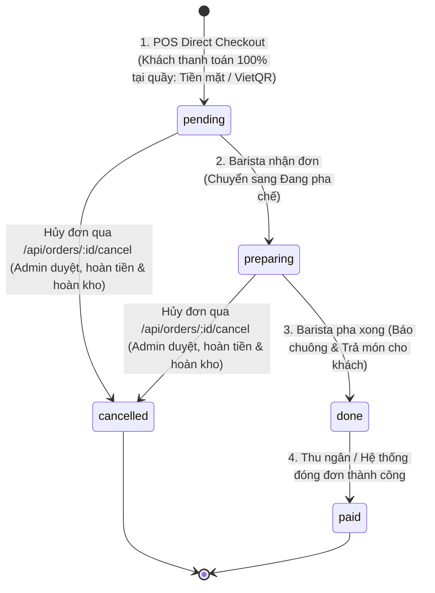

# ☕ MY COFFEE HOUSE - PREMIUM COFFEE & CAFE MANAGEMENT SYSTEM
> Hệ thống quản lý toàn diện quán cà phê / chuỗi F&B chuyên nghiệp. Hỗ trợ đầy đủ nghiệp vụ Bán hàng tại quầy (POS), Màn hình pha chế thời gian thực (KDS), Định lượng nguyên liệu (Recipes), Quản lý kho, Phân ca làm việc và Báo cáo doanh thu chuẩn xác.

---

## 📌 1. TỔNG QUAN DỰ ÁN & CÔNG NGHỆ (TECH STACK)

- **Frontend**: React 18, Vite, React Router v6, Tailwind CSS / Vanilla CSS Variables, Recharts, React Hot Toast, Socket.IO Client.
- **Backend**: Node.js, Express 5, Socket.IO Server, JWT (Access Token + Refresh Token), Bcryptjs, Express Rate Limit, Helmet.
- **Cơ sở dữ liệu**: MySQL 8.x (chuẩn hóa 27 bảng, InnoDB, UTF-8 MB4 Unicode, Foreign Key constraints & Check constraints).
- **Mô hình hoạt động**: Quán cà phê thanh toán trước tại quầy (Upfront Counter Payment) kết hợp hiển thị pha chế live qua WebSockets.

---

## 👥 2. MA TRẬN PHÂN QUYỀN VAI TRÒ (RBAC MATRIX)

Hệ thống thiết lập phân quyền chặt chẽ từ giao diện người dùng (Role Route Guards) đến các Endpoint API phía Server:

| Vai trò | Mã định danh | Tab & Màn hình được phép truy cập | Quyền hạn nghiệp vụ |
| :--- | :--- | :--- | :--- |
| **Quản Lý Quán** | `admin` | Toàn bộ 12 màn hình hệ thống | Toàn quyền cấu hình menu, duyệt hủy đơn đã thanh toán, quản lý nhân sự, xem toàn bộ báo cáo tài chính. |
| **Thu Ngân** | `cashier` | Tổng quan, POS Bán hàng, List đơn, Khách hàng, Khuyến mãi, Lịch ca, Báo cáo | Bán hàng trực tiếp tại quầy, thu tiền mặt/VietQR, tạo mã giảm giá, tra cứu điểm thành viên. |
| **Pha Chế** | `barista` | Màn hình KDS (`/barista`), Quản lý đơn, Định lượng công thức (`/recipes`), Lịch ca | Nhận đơn pha chế theo thời gian thực (Socket.IO), xem công thức định lượng, cập nhật trạng thái đồ uống. |
| **Phục Vụ Bàn** | `waiter` | POS Bán hàng, Quản lý đơn hàng, Lịch phân ca | Xem sơ đồ bàn, hỗ trợ khách gọi thêm món, xác nhận trả món đã hoàn tất cho khách. |
| **Thủ Kho** | `warehouse` | Kho nguyên liệu (`/inventory`), Thống kê kho (`/reports`), Lịch phân ca | Quản lý định mức nguyên vật liệu, điều chỉnh kiểm kê, theo dõi cảnh báo hết hàng, quản lý nhà cung cấp. |

---

## 🔄 3. LUỒNG TRẠNG THÁI ĐƠN HÀNG (STATE MACHINE)



> **Quy tắc bảo vệ doanh thu & kho:**
> - Các đơn đã thanh toán (`payment_status = 'paid'`) chỉ có Quản lý (`admin`) mới có quyền duyệt hủy.
> - Khi hủy đơn, hệ thống tự động: Đánh dấu hủy hóa đơn (`voided`), hoàn tiền theo đúng phương thức thanh toán gốc (`payments.type = 'refund'`), hoàn trả nguyên liệu vào kho (`rollbackInventory`), và thu hồi điểm tích lũy thành viên.
> - Chặn tuyệt đối việc chuyển trạng thái ngược luồng (ví dụ: `done` không thể quay lại `pending`).

---

## 🗄️ 4. KIẾN TRÚC CƠ SỞ DỮ LIỆU (DATABASE SCHEMA)

Hệ thống sở hữu schema thống nhất tại `backend/src/config/schema.sql` gồm **27 bảng**:
1. `roles`: Danh mục vai trò và mô tả quyền hạn (`admin`, `cashier`, `waiter`, `barista`, `warehouse`).
2. `users`: Thông tin tài khoản nhân viên, mã nhân viên, mật khẩu mã hóa bcrypt, chức vụ.
3. `work_shifts`: Lịch phân ca làm việc của từng nhân sự (Ca sáng, Ca chiều/tối, Ca đêm).
4. `areas`: Danh mục khu vực quán (Tầng 1, Tầng 2, Sân thượng).
5. `tables`: Danh sách bàn và trạng thái phục vụ (`empty`, `occupied`, `reserved`, `disabled`).
6. `categories`: Danh mục thực đơn (Cà phê pha phin, Espresso & Latte, Trà trái cây, Đá xay & Sinh tố, Đồ ăn vặt).
7. `products`: Danh mục món đồ uống & thức ăn, hình ảnh, mã sản phẩm.
8. `product_sizes`: Size món (Nhỏ, Vừa, Lớn) và giá niêm yết tương ứng.
9. `toppings`: Danh mục topping thêm (Trân châu trắng, Thạch đào, Kem Cheese, Hạt sen...).
10. `ingredients`: Kho nguyên liệu (Cà phê hạt Robusta, Sữa tươi, Sữa đặc, Đào ngâm...), số lượng tồn, giá vốn bình quân.
11. `recipes`: Định lượng pha chế chuẩn cho từng size đồ uống (liên kết món và nguyên liệu kho).
12. `suppliers`: Nhà cung cấp nguyên vật liệu và công nợ.
13. `stock_receipts`: Hóa đơn nhập kho nguyên vật liệu.
14. `stock_receipt_items`: Chi tiết từng mặt hàng trong phiếu nhập kho.
15. `stock_movements`: Sổ theo dõi lịch sử xuất/nhập/hao hụt/bán hàng của kho nguyên liệu.
16. `membership_tiers`: Bảng hạng mức khách hàng thành viên (Đồng, Bạc, Vàng, Kim Cương) và mức chiết khấu.
17. `customers`: Thông tin khách hàng, số điện thoại, điểm tích lũy, tổng chi tiêu.
18. `loyalty_transactions`: Nhật ký tích điểm và sử dụng điểm của khách hàng.
19. `cash_shifts`: Ca thu ngân và đối soát tiền mặt đầu/cuối ca.
20. `promotions`: Các chương trình khuyến mãi, voucher giảm giá theo % hoặc tiền mặt, điều kiện tối thiểu và giảm tối đa.
21. `orders`: Đơn hàng bán ra, hình thức mua, tổng tiền, thuế, giảm giá, trạng thái đơn và thanh toán.
22. `order_items`: Chi tiết các món trong đơn hàng và tiến độ thực hiện.
23. `order_item_toppings`: Topping kèm theo từng món trong đơn.
24. `document_counters`: Bộ đếm số tự động sinh mã hóa đơn HD-YYYYMMDD-XXXX.
25. `invoices`: Hóa đơn giá trị gia tăng in cho khách hàng (`issued`, `voided`).
26. `payments`: Lịch sử giao dịch thanh toán và hoàn tiền (Tiền mặt, VietQR, Chuyển khoản, Điểm).
27. `audit_logs`: Nhật ký kiểm toán các thao tác nhạy cảm trong hệ thống.

---

## 🚀 5. HƯỚNG DẪN CÀI ĐẶT & CHẠY ỨNG DỤNG

### Bước 1: Khởi tạo Cơ sở Dữ liệu MySQL
Mở MySQL Workbench hoặc terminal MySQL và chạy file khởi tạo schema hợp nhất:
```bash
mysql -u root -p < backend/src/config/schema.sql
```

### Bước 2: Cài đặt và cấu hình Backend
```bash
cd backend
npm install
cp .env.example .env
```
Cấu hình thông số DB trong file `.env`:
```env
PORT=5000
DB_HOST=localhost
DB_PORT=3306
DB_USER=root
DB_PASSWORD=your_mysql_password
DB_NAME=my_coffee_house
JWT_SECRET=your_jwt_secret
```
Khởi chạy Backend:
```bash
npm run dev     # Chạy server ở chế độ dev với hot-reload
# hoặc:
npm start       # Chạy server ở chế độ production
```

### Bước 3: Cài đặt và cấu hình Frontend
Mở một cửa sổ terminal mới:
```bash
cd frontend
npm install
npm run dev     # Khởi chạy Vite Dev Server tại http://localhost:5173
```

---

## 🔑 6. TÀI KHOẢN TRẢI NGHIỆM MẶC ĐỊNH

Tất cả các tài khoản thử nghiệm sử dụng chung mật khẩu: **`123456`**

| Tên đăng nhập | Mật khẩu | Họ và tên | Vai trò |
| :--- | :--- | :--- | :--- |
| `admin` | `123456` | Nguyễn Hoàng Long | 👑 Quản Lý Quán |
| `cashier` | `123456` | Lê Thu Hà | 💵 Thu Ngân |
| `barista` | `123456` | Đặng Minh Tuấn | ☕ Pha Chế (Barista) |
| `waiter` | `123456` | Hoàng Văn Nam | 🍽️ Phục Vụ Bàn |
| `warehouse` | `123456` | Bùi Quốc Hoàng | 📦 Thủ Kho |

---

## 🧪 7. KIỂM THỬ HỆ THỐNG TỰ ĐỘNG (INTEGRATION TESTS)

Hệ thống tích hợp bộ kịch bản kiểm thử tự động xác minh toàn diện 9 tiêu chí:
1. Đăng nhập và cấp phát JWT token cho cả 5 vai trò.
2. Kiểm tra RBAC: Thu ngân truy cập Báo cáo Dashboard (HTTP 200).
3. Kiểm tra RBAC: Thủ kho truy cập Báo cáo Kho (HTTP 200).
4. Kiểm tra phân ca làm việc không lỗi (Fix `r.description` thành công).
5. Kiểm tra bảo mật: Thủ kho bị chặn khi cố cập nhật trạng thái đơn (HTTP 403 Forbidden).
6. Kiểm tra tính tiền Direct POS kèm mã khuyến mãi (COFFEE10 giảm chuẩn xác, không lỗi NaN).
7. Kiểm tra State Machine: `pending` -> `preparing` -> `done`, chặn chuyển ngược luồng (HTTP 400).
8. Kiểm tra duyệt hủy đơn chuẩn qua `/cancel`: Hủy hóa đơn, hoàn tiền đúng phương thức, hoàn trả kho.
9. Kiểm tra tính doanh thu tức thời trên Dashboard ngay khi đơn thanh toán tại quầy.

Chạy kiểm thử:
```bash
cd backend
npm test
```

